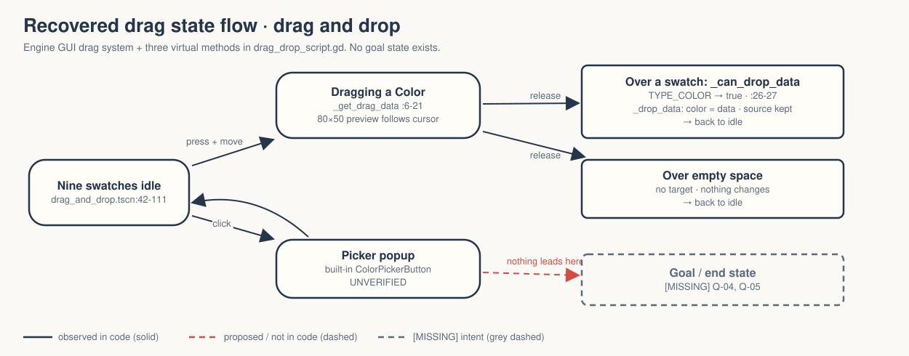
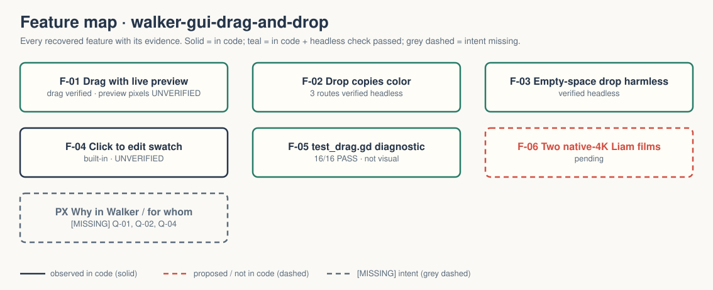

# walker-gui-drag-and-drop — Game Design Document (recovered)

| | |
|---|---|
| Version | 0.1.0-recovered |
| Date | 2026-09-27 |
| Author | Zelda (agent, silent), for Nik Bear Brown |
| Mode | recovered — `/gdd reverse --path godot silent` |
| Revision | 1 |
| Gates | gate — unsigned at time of writing · vision ○ · systems ○ · world ○ · scope ○ |
| Source | Godot demo `gui/drag_and_drop`, commit `a3b5c113112f77291d5f3d1360f33a882fdc52f7`; Walker change is the project title only |
| What this is | **A tech demo, not a game.** Nine color swatches; drag one onto another to copy its color. |

Provenance tags: `[OBSERVED path:line]` the code or a project file does this · `[INFERRED]` the code strongly implies this, evidence stated · `[MISSING]` nothing in the folder can tell us this; each one is an open question in `design/decisions.md`. Paths are relative to the project folder (the folder that contains `godot/`). This file is identical at `GDD.md` and `design/GDD.md`.

A recovered GDD describes what exists. It approves nothing.

Evidence image: `godot/screenshots/drag_and_drop.webp` is the **upstream** screenshot retained with the copy `[OBSERVED README.md:3-5]`. It is not a Walker capture; the rendered drag preview is unverified `[OBSERVED README.md:9]`.

## 1. Vision summary

**Logline (recovered).** "A demo showcasing drag and drop functionality. Drag and drop the color buttons to copy their colors over. Click on the buttons to manually adjust their color." `[OBSERVED godot/project.godot:14-17]`

**What it teaches.** Godot's three Control drag-and-drop virtual methods, in one 33-line script: `_get_drag_data` (what you pick up, plus a preview), `_can_drop_data` (what a target accepts), `_drop_data` (what happens on release) `[OBSERVED godot/drag_drop_script.gd:6-33]`.

**Player fantasy / goal.** None. There is no target palette, no score, no end `[OBSERVED — no other script, no state]`. The on-screen instruction invites play without a goal: "Drag colors from button to button, or change button colors and drag them again." `[OBSERVED godot/drag_and_drop.tscn:28]`

**Why it is in Walker, and for whom.** `[MISSING → Q-01, Q-02]` The folder records verification and two pending films `[OBSERVED README.md:7-10]`; it does not say why.

## 2. Design pillars

`[MISSING → Q-03]` None declared. The code implies `[INFERRED from godot/drag_drop_script.gd]`:
- **Same object is source and target.** Every swatch runs the same script, so any swatch can give and receive.
- **Type is the contract.** A target accepts anything whose type is `Color`, nothing else (line 27).

## 3. Core loop

- **Second to second.** Press on a swatch, move, and a floating 80×50 copy of the swatch follows the cursor `[OBSERVED godot/drag_drop_script.gd:8-18]`; release over another swatch and that swatch takes the color `[OBSERVED godot/drag_drop_script.gd:32-33]`; the source keeps its color `[OBSERVED drag-local-expanded-20260927.log "source color retained"]`. Release over empty space and nothing changes `[OBSERVED same log, "empty-space drop preserves colors"]`.
- **Alternative action.** Click (no drag) a swatch to open Godot's built-in color picker popup and edit it `[OBSERVED godot/project.godot:17; ColorPickerButton built-in]`. **Unverified** in any test `[OBSERVED README.md:9]`.
- **Session.** Launch into one scene; there is no end state, reset, or save `[OBSERVED]`.

It is a sandbox loop: actions have visible consequences but no objective. `[INFERRED]`

## 4. Player Experience Goals

`[MISSING → Q-04]` None declared. The structure could serve "feel how drag-and-drop is wired in Godot" (a developer goal, not a player goal) `[INFERRED]`. Colors can only be copied, never mixed, so no creative goal is supported beyond rearranging nine swatches `[OBSERVED godot/drag_drop_script.gd:33 assigns, does not blend]`.

## 5. Mechanics

- **M-01 Pick up** — `_get_drag_data` builds a new ColorPickerButton of size 80×50 as preview, centers it on the cursor, returns the swatch's `color` `[OBSERVED godot/drag_drop_script.gd:6-21]`.
- **M-02 Accept** — `_can_drop_data` returns true when `typeof(data) == TYPE_COLOR` `[OBSERVED godot/drag_drop_script.gd:26-27]`. Any swatch, including the source itself, accepts a color `[INFERRED — no identity check]`. Rejected-drop feedback is untested `[OBSERVED FRICTIONAL.md:23-24]`.
- **M-03 Drop** — `_drop_data` sets `color = data` `[OBSERVED godot/drag_drop_script.gd:32-33]`.
- **M-04 Edit** — clicking a ColorPickerButton opens its picker popup `[INFERRED — built-in behavior of the node type at godot/drag_and_drop.tscn:42-111]`; unverified.
- **M-05 Nine starting colors** — red, orange, green, teal, cyan, blue, violet, magenta, warm grey in a 3-column grid, each swatch 96×64 minimum `[OBSERVED godot/drag_and_drop.tscn:40-111]`.

## 6. Systems

- **S-01 Scene.** One scene: root Control `DragAndDrop` → Label `Information` + GridContainer of 9 ColorPickerButtons, all with `drag_drop_script.gd` `[OBSERVED godot/drag_and_drop.tscn:5-111]`.
- **S-02 Data flow.** The engine's GUI drag system carries a `Color` from source to target; no custom signal, autoload, or shared state `[OBSERVED]`.
- **S-03 Input.** No `[input]` section; mouse only via built-in GUI handling `[OBSERVED godot/project.godot]`.
- **S-04 Display.** `canvas_items` stretch, `expand` aspect, vsync off, low-processor mode `[OBSERVED godot/project.godot:21,30-32]`.
- **S-05 Save/load, transitions.** None.

## 7. Progression

None `[OBSERVED]`.

## 8. World

None. A label and a grid of swatches on the default background `[OBSERVED godot/drag_and_drop.tscn]`. No lore.

## 9. Narrative

None. Reasoned N/A.

## 10. Characters

None.

## 11. Features and priority

| ID | Feature | Tag | PX | Evidence | Status |
|---|---|---|---|---|---|
| F-01 | Drag a color with a live preview (M-01) | untagged | none declared | drag_drop_script.gd:6-21 | drag start verified headless; **preview pixels unverified** |
| F-02 | Drop copies color, source kept (M-02, M-03) | untagged | none | :26-33 | verified headless (3 routes) |
| F-03 | Drop on empty space is harmless | untagged | none | same | verified headless |
| F-04 | Click to edit a swatch (M-04) | untagged | none | node type | **unverified** |
| F-05 | Headless diagnostic `test_drag.gd` | Walker tooling | — | 16/16 in drag-local-expanded-20260927.log | passes; not visual |
| F-06 | Two native-4K Liam films | Walker production | — | README.md:10 | **pending** |

**CORE percentage:** not computable; nothing is tagged and no MVP is defined `[MISSING → Q-05]`.

## 12. Out of scope

By absence, not decision `[INFERRED]`: mixing colors, undo, reset, drag between windows, keyboard-driven drag, accessibility of drag-and-drop, persistence.

## 13. Technical

Godot 4.7.2 stable `[OBSERVED README.md:7; runtime-20260927.log]`, features "4.7", GL Compatibility `[OBSERVED godot/project.godot:20,36-37]`. Untyped-declaration warnings on `[OBSERVED godot/project.godot:26]`. Scene is authored at 1152×675 while the diagnostic root window was 1024×600; the mismatch is why the first harness failed, and it was a harness problem, not a demo bug `[OBSERVED FRICTIONAL.md:31-37; drag-local-expanded-20260927.log GEOMETRY line]`. Assets: icon, upstream screenshot; L4 upstream. Differs from the upstream checkout only by the title line and `test_drag.gd(.uid)` `[OBSERVED — directory diff 2026-09-27]`.

## 14. Risks

| ID | Risk | Evidence | Mitigation |
|---|---|---|---|
| R-01 | Early failing logs are read as a demo bug | drag-20260927.log etc. 6 failures; FRICTIONAL.md:31-37 | keep the harness-routing explanation next to the logs |
| R-02 | 16 headless passes are read as "drag and drop verified" | README.md:8-9 | say "synthetic state checks" every time |
| R-03 | Film shows click-to-edit, which nobody has tested | README.md:9 | test or omit before capture |
| R-04 | No stated purpose, so no definition of done | §1 | Q-01 |

## 15. Open questions

Kept in `design/decisions.md`: Q-01 purpose in Walker · Q-02 audience · Q-03 pillars / upstream-faithful · Q-04 PX goal · Q-05 scope beyond upstream (reset, mixing, goal palette?) · Q-06 film plan · Q-07 visual QA owner.

## 16. Tests

Existing (`godot/test_drag.gd`, `root.push_input` with viewport-local positions, 16 assertions, 0 failures) `[OBSERVED drag-local-expanded-20260927.log]`: T-01 nine color buttons · T-02..T-13 three drag routes (0→8, 4→2, 6→1), each: drag starts, drop copies color, source retained, release ends drag · T-14..T-16 drag released over empty space starts, ends, preserves all colors. Earlier logs with 6 failures are kept as history `[OBSERVED drag-20260927.log, drag-hover-, drag-parsed-, drag-routing-]`.

Proposed (dashed in the deck, not written): H-01 visible preview follows the cursor at native resolution; H-02 click-to-edit changes a swatch; H-03 dropping a swatch on itself is a no-op to the eye.

## Zelda's read — 7 Failure Mode audit

| Mode | Rating | Evidence |
|---|---|---|
| Ghost Center | PRESENT (expected) | §1 purpose `[MISSING]` |
| Mechanic Mirage | PRESENT (expected) | §4: the only goal-like line describes the mechanic |
| Implementation Void | PARTIAL | self-drop, rejected drop and picker edit are neither documented upstream nor tested |
| Priority Inflation | N/A | no tags |
| Novelist's Trap | ABSENT | no lore |
| Completeness Fallacy | ABSENT | the harness story is fully written in FRICTIONAL.md |
| Stagnant Artifact | ABSENT from now | CHANGELOG.md started |

What the structure suggests the vision was `[INFERRED]`: the smallest possible worked example of Godot's drag-and-drop contract. It does that well. It has no player reason to drag, and that is fine for what it is.

## Zelda's notes (silent mode; what I would have said out loud)

1. This is the cleanest demo in the batch: one script, three methods, one data type. Do not decorate it.
2. The failing logs are the interesting part for a teaching film: the demo was fine, the test was aiming at the wrong coordinates. That is a real lesson about headless input. If Q-01 says "teaching," use it.
3. Click-to-edit is the unverified half of the upstream description. Test it or leave it out of any film.
4. First fix: answer Q-01.
